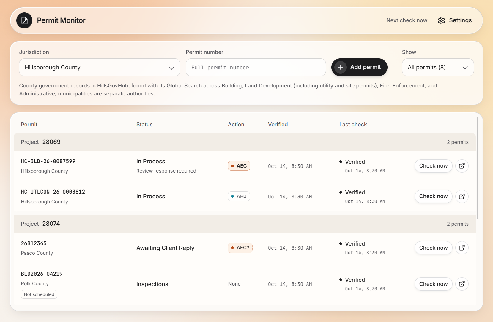
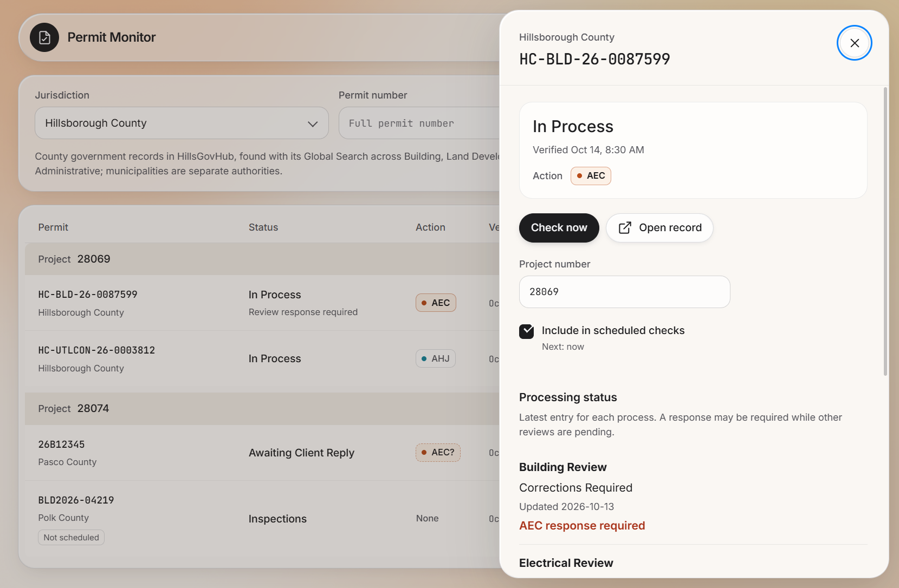

# Permit Monitor

Permit Monitor is a desktop app for Windows and macOS that tracks building permits across Florida's county and city permit portals and its five water management districts. You add a permit number once. The app then checks the issuing authority's public portal on a schedule, records the exact status the portal shows, and notifies you when it changes.

It was built for an engineering firm that follows dozens of permits at once across portals that have no shared API and look nothing alike.



## Features

- **Ten local authorities and five water management districts.** Hillsborough, Pasco, Pinellas, Hernando, Polk, Orange, and Baker counties; Tampa, St. Petersburg, and Palm Bay; and SWFWMD, SFWMD, SJRWMD, SRWMD, and NWFWMD. Three portals that require a login, a CAPTCHA, or a human browser check are tracked by hand: the app opens the search, copies the number, and records the status you enter.
- **Verified statuses only.** A status is saved only after the browser has matched the full permit number on the record page and read the record-level status field. A failed check never overwrites the last verified status or its time.
- **Scheduled and on-demand checks.** Checks run at 8:30 AM, 12:30 PM, and 4:30 PM by default, configurable up to eight times a day. A time missed while the computer slept is made up once, but never overnight. Checks on the same portal are spaced at least 30 seconds apart.
- **Action column.** Portal wording is shown exactly as written. Next to it, the app says who the status waits on: the applicant (**AEC**), the authority (**AHJ**), or no one. The mapping comes from a [survey of each portal's statuses](docs/PERMIT_STATUSES.md). Unknown wording is marked **AEC?** so nothing that might need a response is missed.
- **Review tracking for Accela portals.** Checks read each review discipline's history and flag a current "Corrections Required" or equivalent, even while the overall record status is unchanged.
- **Desktop notifications** for status changes, new correction requests, and the first failure in a run of failed checks.
- **Shared read-only lists.** One person shares their list with a code, and coworkers follow it without an account or API key. The list is encrypted with AES-256-GCM before it leaves the app, and the code holds the only key.
- **Signed auto-updates** on Windows from an Ed25519-signed release feed.



## How it works

The app has three Electron processes with narrow, parsed interfaces between them.

| Process                       | Owns                                                                                                             |
| ----------------------------- | ---------------------------------------------------------------------------------------------------------------- |
| Renderer (`src/renderer`)     | The UI, in plain TypeScript and DOM APIs. It talks to main only through a small preload bridge.                  |
| Main (`src/main`)             | SQLite storage, the scheduler and check queue, the encrypted API key, update verification, and sharing.          |
| Browser worker (`src/worker`) | Playwright and a bundled Chromium headless shell, in an Electron utility process. One adapter per portal family. |

Each check starts a fresh browser context in its own worker process. The worker drives the portal's search, reads the record, and sends main a bounded observation. Main validates it again before saving: the permit number must match under the jurisdiction's comparison rules, the label must be a known record-level status label, and the record link must stay on the authority's approved portal.

Most navigation steps are deterministic. When the worker offers a single step its own checks have established, such as a visible search field or an exact-match result, main approves it without a model call. When a page offers several possible actions, main sends filtered page text and the candidate actions to a hosted classification model, TypeSafe's Jev. The model can only pick one of the offered actions, and main accepts the choice only above a confidence and margin threshold. The worker checks the page again before acting.

Portal families supported: Accela (five authorities), Tyler Civic Access, Click2Gov, SWFWMD's WMIS, SFWMD's RegPermitting, and the ePermit system shared by three districts. See the [portal research](docs/FL_PERMIT_PORTALS.md) for each portal's search inputs and quirks.

Two Cloudflare Workers support the desktop app:

- `infra/update-server` serves the signed update feed and installers from R2.
- `infra/sync-server` stores shared lists, with one SQLite-backed Durable Object per list. It only ever sees ciphertext. See [shared lists](docs/SHARING.md).

### Engineering choices

- **Parse at every boundary.** IPC messages, worker messages, SQLite rows, and network responses are parsed with Zod where they enter. A strict Oxlint configuration, including the vendored [anti-slop](https://github.com/dmmulroy/anti-slop) rules in `tools/oxlint/anti-slop`, rejects unchecked type assertions, `unknown` parameters, and non-null assertions.
- **No native modules.** Storage uses Node's built-in `node:sqlite`, so building the app needs neither Visual Studio nor Python.
- **Secrets stay in main.** The API key is sent once from the settings field, encrypted with Electron `safeStorage` (DPAPI on Windows, the Keychain on macOS), and never returned to the renderer, passed to the browser worker, logged, or stored in the database.
- **Supply-chain checks.** The bundled browser is verified against a SHA-256 manifest before it is launched. The update feed is signed with Ed25519, and each installer is checked against the SHA-256 hash in the signed manifest before it runs.
- **Redacted diagnostics.** Failures the UI shows only generically are logged to `diagnostics.jsonl` as classified causes, without messages, paths, permit data, or keys.

## Development

Requires Node.js 24.

```sh
npm ci --allow-git=all     # the lockfile has a git dependency from Electron Forge
npm run browser:stage      # download the pinned Chromium headless shell
npm run typecheck
npm run lint
npm run format:check
npm test
npm run dev
```

Renderer and worker tests run in the staged browser against recorded portal pages, so stage it before running `npm test`.

Saving an API key requires Windows or macOS key storage. On Linux or WSL, an unpackaged development run can read the key from the environment instead. Main reads it once at startup and removes it from its environment. Packaged builds ignore it.

```sh
TYPESAFE_API_KEY=... npm run dev
```

To check a portal without an API key, run a live smoke check. It applies the same verification main does before saving and prints the result:

```sh
npm run smoke:portal -- BLDR-004412-2026 hernando-county-building
```

To try shared lists locally, run the sync Worker and point the app at it. A second instance with its own data folder can follow the first:

```sh
npx wrangler dev --config infra/sync-server/wrangler.jsonc --port 8787
SHARE_SERVICE_URL=http://127.0.0.1:8787 npm run dev
npx electron . --user-data-dir=/tmp/permit-monitor-2
```

### Windows builds from WSL

Windows npm can't run from a `\\wsl.localhost\...` path. `npm run sync:windows` mirrors the source to `C:\Users\<you>\dev\aecPermitViewer`, where you can install and run as above in PowerShell. `npm run make:win` builds the Squirrel installer, and `npm run package:mac` builds the Mac app on a Mac.

## Releases

Pushing an annotated `vX.Y.Z` tag runs CI, which builds the Windows installer and the Mac app, publishes them to the update feed, and creates a GitHub release. Installed Windows copies update themselves from the signed feed. [docs/RELEASE.md](docs/RELEASE.md) covers signing keys, qualification, and the Mac build.

## Repository layout

```
src/main        Electron main process
src/preload     Preload bridge exposed to the renderer
src/renderer    UI
src/worker      Playwright browser worker and portal adapters
src/shared      Domain logic and message schemas shared across processes
infra/          Cloudflare Workers for updates and shared lists
scripts/        Build, browser staging, release, and smoke-check scripts
tests/          Vitest suites and recorded portal fixtures
docs/           Portal research, status survey, design notes, and release process
```

## License

Copyright (c) 2026 Stephen Frederick. All rights reserved. The source is published for reference only; see [LICENSE](LICENSE). Third-party components keep their own licenses.
